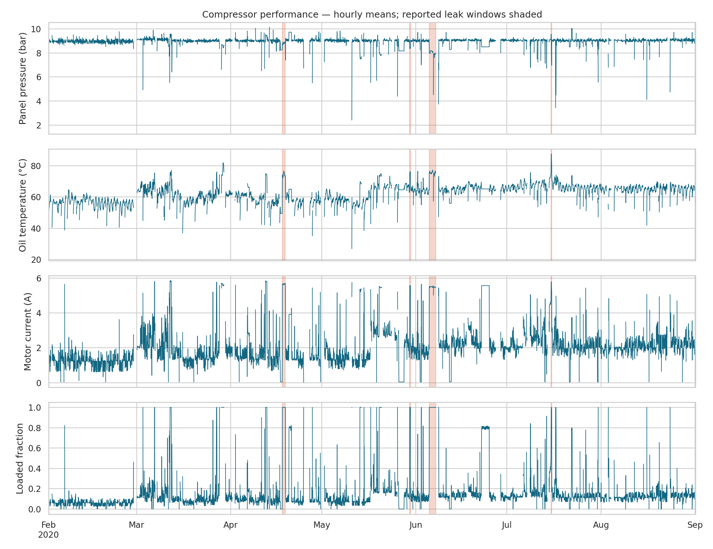
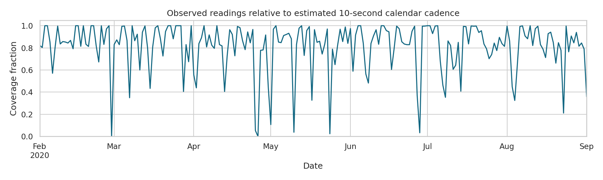
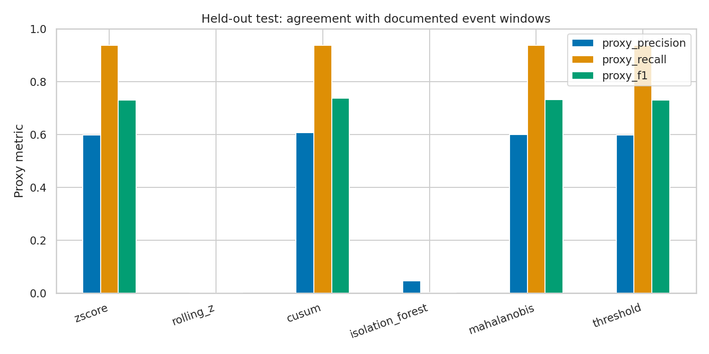
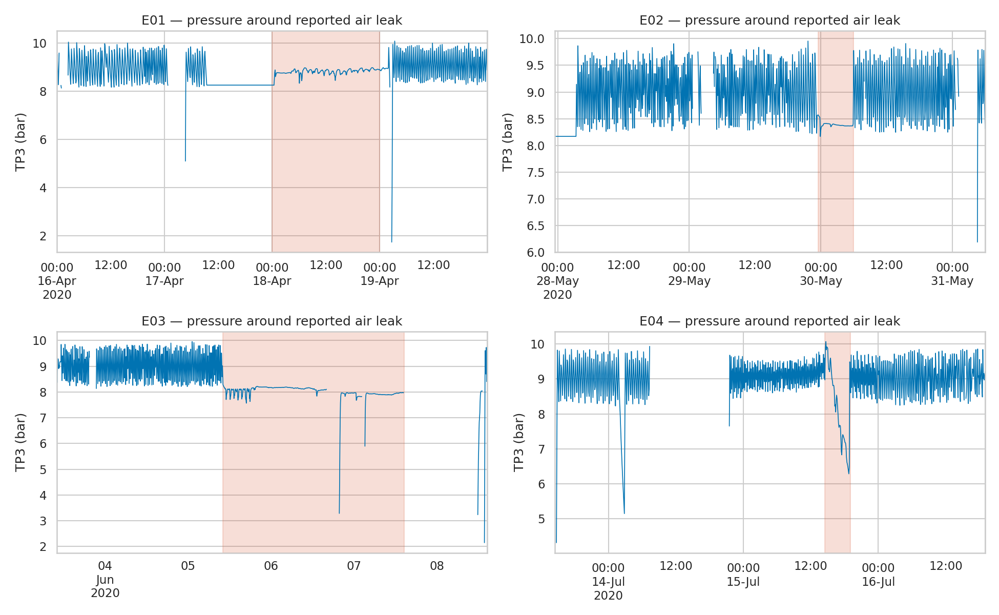
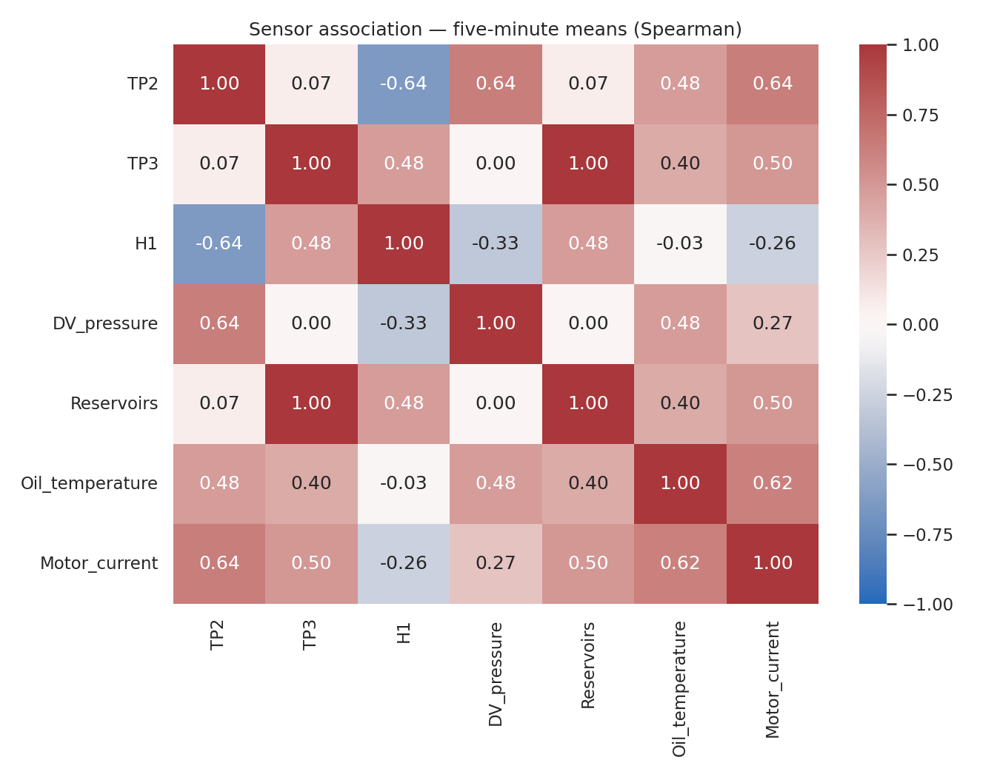

# Hardware performance and failure investigation

Analysed **1,516,948 readings**, from 2020-02-01 00:00:00 to 2020-09-01 03:59:50. Input provenance and SHA-256 are in `run_manifest.json`.

## Data quality and operating context
- Median sampling interval: 10 seconds; 99th percentile: 12 seconds.
- 331 gaps exceed three median sampling intervals. Longest gap: 48.03 hours.
- Estimated coverage across the entire calendar span: 82.36%. Missing observations do not prove equipment downtime.
- Removed 0 exact duplicates; quarantined 0 rows sharing conflicting timestamps and 0 invalid timestamps.
- 48,279 of 61,392 five-minute bins meet at least 80% sampling coverage and 95% complete readings, with at most 20% of readings flagged for simultaneous analog flatlining.
- Complete loaded-state runs: 15,539; median duration: 2.15 minutes. Runs at gaps and dataset boundaries are censored.

All seven analog sensors were simultaneously flatlined for at least ten minutes in 50,338 readings. These are possible stale-telemetry episodes; their cause is unconfirmed. Bins with more than 20% such readings are excluded from model fitting and evaluation. See `simultaneous_flatline_episodes.csv`.

## Performance
Eligible-bin mean panel pressure: 9.000 bar; oil temperature: 62.64 °C; motor current: 2.023 A.
These are observed descriptive values, not manufacturer operating limits. Pressure differences and load duty are diagnostic context. Low negative pressure readings are retained because calibration offsets cannot be resolved from the CSV alone.

## Chronological anomaly evaluation
February fits the models; March calibrates the 99th-percentile score thresholds without event labels. April onward is held out. Alerts require the current score to exceed its threshold and at least one of the previous two scores to exceed; all three bins must be quality eligible. Rolling features use previous observations only.
Precision, recall and F1 below measure agreement with reported event intervals. Outside-window alerts are proxy false positives, not confirmed false alarms. The event log may be incomplete. No test-set tuning is performed.

| Detector | Proxy precision | Proxy recall | Proxy F1 | Events detected | Outside-window episodes / observed day |
|---|---:|---:|---:|---:|---:|
| zscore | 0.598 | 0.937 | 0.730 | 75% | 0.18 |
| rolling_z | 0.000 | 0.000 | 0.000 | 0% | 0.00 |
| cusum | 0.607 | 0.936 | 0.736 | 75% | 0.12 |
| isolation_forest | 0.045 | 0.001 | 0.002 | 25% | 0.18 |
| mahalanobis | 0.599 | 0.937 | 0.731 | 75% | 0.18 |
| threshold | 0.598 | 0.937 | 0.730 | 75% | 0.19 |

The highest observed test proxy F1 is 0.736 for cusum. This is a descriptive comparison, not a fresh independent validation of a selected production model.

## Documented failures and early warnings
The four reported intervals total 87.48 hours. This is reported event exposure, **not measured downtime**. MTBF, MTTR, operational uptime and RUL are not estimated because verified operating-hours and repair/outage logs are absent.
Early-warning lead time is measured from the first eligible alert in the preceding 24 hours to the reported start. Frequent background alerts can produce apparent lead time by chance; interpret with outside-window alert burden. See `event_evaluation.csv` for every detector and event.

| Event | IF detected during interval | IF alert bins | Prior-24h warning lead (hours) |
|---|---|---:|---:|
| E01 | False | 0 | No warning |
| E02 | False | 0 | No warning |
| E03 | True | 1 | No warning |
| E04 | False | 0 | No warning |

## Sensor changes around failures
Each event is compared with the preceding seven days, excluding other reported events and poor-quality bins. Hourly means are resampled 1,000 times for descriptive 95% bootstrap intervals; Welch tests and Benjamini–Hochberg corrections are exported. Hourly blocks can still be serially dependent and operating-state mix can confound differences. These are exploratory associations, not causal failure mechanisms.

| Event | Sensor | Baseline mean | Event mean | Difference | 95% descriptive interval |
|---|---|---:|---:|---:|---|
| E01 | TP3 | 9.061 | 8.816 | -0.246 | [-0.291, -0.201] |
| E01 | Oil_temperature | 58.056 | 74.377 | 16.321 | [15.140, 17.501] |
| E01 | Motor_current | 1.994 | 5.664 | 3.670 | [3.436, 3.897] |
| E02 | TP3 | 8.972 | 8.565 | -0.407 | [-0.635, -0.026] |
| E02 | Oil_temperature | 66.547 | 75.662 | 9.115 | [8.387, 9.926] |
| E02 | Motor_current | 2.502 | 5.453 | 2.950 | [2.649, 3.164] |
| E03 | TP3 | 8.996 | 7.970 | -1.026 | [-1.157, -0.929] |
| E03 | Oil_temperature | 64.400 | 75.328 | 10.928 | [10.169, 11.513] |
| E03 | Motor_current | 1.921 | 5.487 | 3.567 | [3.471, 3.658] |
| E04 | TP3 | 9.008 | 8.526 | -0.483 | [-1.345, 0.289] |
| E04 | Oil_temperature | 68.419 | 82.714 | 14.295 | [10.562, 17.453] |
| E04 | Motor_current | 2.806 | 5.267 | 2.461 | [1.703, 2.974] |

## Engineering recommendations
1. Review persistent pressure/current deviations alongside loaded-state duty and sensor agreement before opening a maintenance ticket.
2. Check communication outages separately from mechanical failures; preserve unavailable bins in monitoring.
3. Review flatline flags in operating context. A constant sensor can be legitimate, especially a digital state.
4. Obtain verified shutdown, repair and operating-hour records before publishing reliability KPIs or confirmed false-alarm rates.
5. Pilot alerts in shadow mode; have engineers label episodes and choose an alert budget before deployment.
6. Validate on a later unseen period and additional equipment. Four events on one compressor do not establish fleet-level generalisation.

## Source and reproducibility
Dataset: Davari et al. (2021), MetroPT-3, UCI Machine Learning Repository, DOI 10.24432/C5VW3R, CC BY 4.0.
Source: https://archive.ics.uci.edu/dataset/791/metropt+3+dataset
The source contains both 1 Hz logging and 0.1 Hz released-data descriptions. Analysis uses the measured cadence. Its E02 maintenance note is inconsistent and is excluded from repair/downtime calculations. Timestamps retain source-local interpretation because timezone is not specified.
Run `python -m src.pipeline --csv data/raw/MetroPT3.csv` to regenerate all numbers and charts.
